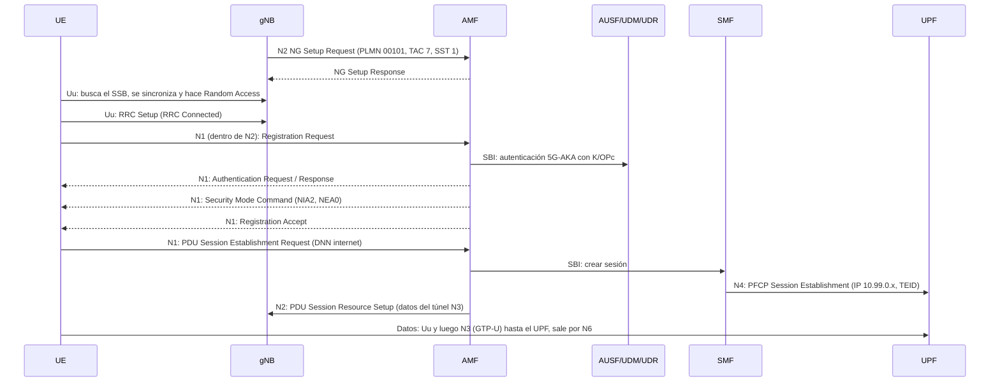

# Guía: montaje de una red 5G simulada (Open5GS + srsRAN)

En este documento detallamos el paso a paso para montar la simulación de la red 5G, que ahora mismo ya está automatizada con contenedores de Docker pero que inicialmente montamos paso a paso. Explicamos cada configuración y por qué la usamos.

La guía tiene seis partes:

| Parte | Tema |
|---|---|
| I | Arquitectura 5G: integración srsRAN–Open5GS e interfaces N1, N2, N3 |
| II | Montaje paso a paso (secciones 2 a 9) |
| III | Codificación y modelado: MCS, LDPC y Polar |
| IV | Simulación y factibilidad: rendimiento y latencia medidos |
| V | Impacto y ética: normativa de espectro e impacto socio-técnico |
| VI | Cómo quedó en el repo con Docker y problemas comunes |
| VII | Validación RF del gNB real (USRP) con una HackRF One |

---

# Parte I. Arquitectura 5G

## 1. Integración srsRAN–Open5GS

Una red 5G tiene 3 partes:

| Pieza | Analogía | Software | Proyecto |
|---|---|---|---|
| **UE** | El celular (con la SIM) | srsUE 25.10 | srsRAN 4G |
| **gNB** | La antena de la operadora | gNB 24.10.1 | srsRAN Project |
| **Core (5GC)** | Es quien autentica, da IP y enruta el tráfico | Open5GS 2.7.7 | Open5GS |

Como no tenemos antena real, simulamos la radio con **ZeroMQ (ZMQ)**: el gNB y el UE se envían las muestras de la señal por TCP. Todo lo demás (codificación, registro, cifrado, túnel de datos) funciona igual que en una red real.

**Dónde se unen srsRAN y Open5GS.** srsRAN pone la parte de radio (UE y gNB) y Open5GS pone el core. Se tocan solo en dos puntos, ambos desde el gNB:
- El gNB se conecta al **AMF** por **N2** (control).
- El gNB se conecta al **UPF** por **N3** (datos).

Para que se entiendan, los dos lados deben compartir los mismos valores: PLMN `001/01`, TAC `7`, slice SST `1` y los datos de la SIM (IMSI, K, OPc). Esto lo detallamos en la sección 4.1.

### 1.1 Funciones del core

| Función | Qué hace |
|---|---|
| **NRF** | Directorio donde todas las funciones se registran y se buscan |
| **AMF** | Portero: recibe al gNB (N2) y maneja el registro y la movilidad del UE (N1) |
| **SMF** | Crea las sesiones de datos y asigna la IP del UE |
| **UPF** | Mueve los paquetes del usuario: recibe el túnel N3 y sale por N6 |
| **AUSF / UDM / UDR** | Autenticación y datos del suscriptor (UDR lee MongoDB) |
| **PCF / BSF / NSSF** | Políticas, sesiones por PCF y selección del slice |

Entre ellas hablan por **SBI**, que son APIs HTTP/2 en el puerto 7777.

### 1.2 Las interfaces en detalle

```
                 N1 (NAS, viaja dentro de N2)
        ┌──────────────────────────────────────────┐
        │                                          ▼
       UE ──Uu (ZMQ)── gNB ───────N2 (NGAP)──────► AMF ──SBI──► AUSF/UDM/UDR, SMF...
                        │                                          │
                        └─────────N3 (GTP-U)──────► UPF ◄──N4 (PFCP)┘
                                                    │
                                                    └──N6──► DN / Internet
```

| Interfaz | Entre | Protocolo | Transporte | Qué viaja | Dónde la configuramos |
|---|---|---|---|---|---|
| **Uu** | UE ↔ gNB | Pila NR (PHY, MAC, RLC, PDCP, RRC) | ZMQ por TCP, puertos 2000/2001 | Muestras IQ de la señal | `ru_sdr` del gNB, `[rf]` del UE |
| **N1** | UE ↔ AMF | NAS-5GS | Dentro de NGAP (N2) | Registro, autenticación, seguridad, pedido de sesión | AMF `security`, UE `[usim]` y `[nas]` |
| **N2** | gNB ↔ AMF | NGAP | SCTP, puerto 38412 | NG Setup, contexto del UE, mensajes NAS encapsulados, orden de crear el túnel | AMF `ngap`, gNB `cu_cp.amf` |
| **N3** | gNB ↔ UPF | GTP-U | UDP, puerto 2152 | Paquetes IP del usuario dentro de un túnel con un TEID (identificador del túnel) | UPF `gtpu`, gNB `cu_up.upf` |
| N4 | SMF ↔ UPF | PFCP | UDP, puerto 8805 | Reglas de cómo tratar cada sesión | SMF `pfcp`, UPF `pfcp` |
| N6 | UPF ↔ Internet | IP | — | Tráfico del usuario ya fuera del túnel | `ogstun` y NAT (sección 4.7) |
| SBI | Entre funciones del core | HTTP/2 | TCP, puerto 7777 | Consultas entre funciones | `sbi` en cada `.yaml` |

**N1** no tiene una conexión propia. El UE no puede hablar directo con el AMF, entonces el gNB mete los mensajes NAS dentro de mensajes NGAP (`Uplink/Downlink NAS Transport`). El gNB no los entiende ni los modifica, solo los pasa. Por eso, en una captura de N2, Wireshark muestra NGAP y adentro NAS-5GS.

**N2** usa SCTP en vez de TCP. SCTP mantiene varios flujos en una sola conexión y detecta caídas más rápido, por eso lo pide el estándar.

**N3** separa el tráfico del usuario del de control. Cada sesión tiene un TEID en cada extremo, y así el UPF sabe a qué UE pertenece cada paquete. En una captura se ve el paquete del UE (por ejemplo un ping desde `10.99.0.x`) metido dentro de UDP/GTP-U entre el gNB y el UPF.

### 1.3 Qué pasa desde que encendemos todo hasta tener Internet



En los logs, los mensajes que confirman cada paso son:
- `gNB-N2 accepted` en el AMF (N2 listo).
- `Random Access Complete` y `RRC Connected` en el UE (radio lista).
- `Registration complete` en el AMF (N1 listo).
- `PDU Session Establishment successful. IP: 10.99.0.x` en el UE (sesión lista).

### 1.4 Capas por las que pasa un paquete del usuario

```
 UE                    gNB                         UPF
 IP (10.99.0.x)  ─────────────────────────────────► IP
 SDAP/PDCP       ──► SDAP/PDCP │ GTP-U   ──────────► GTP-U
 RLC             ──► RLC       │ UDP     ──────────► UDP
 MAC             ──► MAC       │ IP      ──────────► IP
 PHY (LDPC, OFDM)──► PHY       │
       Uu (ZMQ)                      N3
```

El gNB es el que traduce entre las dos mitades: recibe por radio y lo reenvía por el túnel N3.

---

# Parte II. Montaje paso a paso

## 2. Requisitos

- Linux (Ubuntu 22.04; Kali/Debian también sirven).
- 4 GB de RAM, 10 GB de disco, 4 o más núcleos de CPU.
- Internet.

Instalamos las dependencias:

```bash
sudo apt update
sudo apt install -y git build-essential cmake make gcc g++ pkg-config curl gnupg \
  libfftw3-dev libmbedtls-dev libsctp-dev libyaml-cpp-dev libzmq3-dev \
  libboost-program-options-dev libconfig++-dev iproute2 iperf3 iptables
```

Por qué esas librerías:
- **FFTW**: transformadas de Fourier para procesar la señal.
- **mbedTLS**: cifrado.
- **SCTP**: el protocolo que usa N2.
- **ZMQ**: la radio simulada.
- **yaml/config**: leer los archivos de configuración.

---

## 3. Instalación del core (Open5GS)

### 3.1 Base de datos (MongoDB)
Open5GS guarda los suscriptores (las SIMs autorizadas) en MongoDB.

```bash
# Ubuntu 22.04, Mongo 4.4 (ver nota de AVX)
curl -fsSL https://pgp.mongodb.com/server-4.4.asc | sudo gpg --dearmor -o /usr/share/keyrings/mongodb-4.4.gpg
echo "deb [signed-by=/usr/share/keyrings/mongodb-4.4.gpg] https://repo.mongodb.org/apt/ubuntu focal/mongodb-org/4.4 multiverse" \
  | sudo tee /etc/apt/sources.list.d/mongodb-org-4.4.list
sudo apt update && sudo apt install -y mongodb-org
sudo systemctl enable --now mongod
```

> **Nota sobre AVX:** Mongo 5.0 o superior necesita una instrucción de CPU llamada AVX. Muchas máquinas virtuales no la tienen (`lscpu | grep -o avx` sale vacío) y Mongo se cae con "Illegal instruction". Por eso usamos la versión **4.4**.

### 3.2 Open5GS

```bash
sudo add-apt-repository ppa:open5gs/latest
sudo apt update && sudo apt install -y open5gs
```
En Kali/Debian no existe ese PPA, así que lo compilamos desde el código fuente ([docs de Open5GS](https://open5gs.org/open5gs/docs/guide/02-building-open5gs-from-sources/)) con la versión **2.7.7**.

Las configuraciones quedan en `/etc/open5gs/*.yaml`. Después las ajustamos.

---

## 4. Configuración del core

Todas las funciones del core se registran en el **NRF**. Cada función avisa quién es y en qué IP está, y las demás la buscan ahí. Por eso **todas** tienen `client: nrf` apuntando al NRF.

### 4.1 Identidad de la red: PLMN, TAC y slice
Estos valores **tienen que ser iguales en todos lados** (core, gNB, UE y base de datos). Si uno no coincide, el registro falla sin dar un error claro.

| Parámetro | Valor | Qué es |
|---|---|---|
| **PLMN** `MCC/MNC` | `001` / `01` | País y operadora. `001/01` está reservado para pruebas. |
| **TAC** | `7` | Código del área donde está la antena. |
| **SST** (slice) | `1` | Tipo de servicio de red (1 = banda ancha normal). |
| **DNN** | `internet` | Nombre de la red de datos, parecido al APN del celular. |

### 4.2 `/etc/open5gs/nrf.yaml`
```yaml
nrf:
  serving:
    - plmn_id: { mcc: 001, mnc: 01 }   # red que atiende
  sbi:
    server:
      - address: 127.0.0.10
        port: 7777
```
El NRF es lo primero que arrancamos. Aquí definimos el PLMN y su puerto SBI.

### 4.3 `/etc/open5gs/amf.yaml` (el más importante)
```yaml
amf:
  sbi:
    server: [ { address: 127.0.0.5, port: 7777 } ]
    client: { nrf: [ { uri: http://127.0.0.10:7777 } ] }
  ngap:
    server: [ { address: 127.0.0.5 } ]      # N2: aquí se conecta el gNB (puerto 38412)
  guami:
    - plmn_id: { mcc: 001, mnc: 01 }
      amf_id: { region: 2, set: 1 }         # identificador de este AMF
  tai:
    - plmn_id: { mcc: 001, mnc: 01 }
      tac: 7                                # igual al TAC del gNB
  plmn_support:
    - plmn_id: { mcc: 001, mnc: 01 }
      s_nssai: [ { sst: 1 } ]               # slice permitido
  security:
    integrity_order: [NIA2, NIA1, NIA0]
    ciphering_order: [NEA0, NEA1, NEA2]     # NEA0 primero, srsUE no descifra NEA2
```
**Por qué NEA0 primero:** el AMF escoge el primer algoritmo de cifrado de la lista que el UE soporte. srsUE 25.10 no logra descifrar NEA2: el mensaje Registration Accept le llega dañado y el registro se queda colgado. Con NEA0 (NAS sin cifrar) funciona. La integridad sí la dejamos en NIA2, así que los mensajes siguen protegidos contra modificaciones. Esto solo es aceptable porque es un laboratorio aislado (lo retomamos en la sección 12.3).

### 4.4 `/etc/open5gs/smf.yaml` (sesiones de datos)
```yaml
smf:
  sbi:
    server: [ { address: 127.0.0.4, port: 7777 } ]
    client: { nrf: [ { uri: http://127.0.0.10:7777 } ] }
  pfcp:
    server: [ { address: 127.0.0.4 } ]           # N4: SMF escucha
    client: { upf: [ { address: 127.0.0.7 } ] }  # N4: UPF con el que habla
  session:
    - subnet: 10.99.0.0/16                       # IPs que se asignan a los UEs
      gateway: 10.99.0.1
      dnn: internet
  dns: [ 8.8.8.8, 1.1.1.1 ]
  mtu: 1400
```
Cuando el UE pide una sesión, el SMF le asigna una IP del rango `10.99.0.0/16` y le dice al UPF cómo manejar ese tráfico. También le envía los DNS al UE. Usamos `mtu: 1400` para dejar espacio a las cabeceras del túnel GTP y evitar que los paquetes grandes se fragmenten.

### 4.5 `/etc/open5gs/upf.yaml` (por donde pasan los datos)
```yaml
upf:
  pfcp:
    server: [ { address: 127.0.0.7 } ]      # N4
  gtpu:
    server: [ { address: 127.0.0.7 } ]      # N3: llega el túnel del gNB (puerto 2152)
  session:
    - subnet: 10.99.0.0/16
      gateway: 10.99.0.1
      dnn: internet
```
Los valores de `subnet`, `gateway` y `dnn` deben ser **idénticos** a los del SMF.

### 4.6 Las demás funciones (AUSF, UDM, UDR, PCF, BSF, NSSF)
Todas siguen el mismo patrón: su propia IP, puerto 7777 y `client.nrf` apuntando al NRF.

| Función | Extra en su config |
|---|---|
| **AUSF**, **UDM**, **BSF** | Nada |
| **UDR**, **PCF** | `db_uri: mongodb://127.0.0.1/open5gs` (leen MongoDB) |
| **NSSF** | `nsi` → NRF con `sst: 1` |

### 4.7 Interfaz de salida del UPF (`ogstun`)
El UPF necesita una interfaz virtual a donde llegan los paquetes de los UEs, y debe poder reenviarlos a Internet (N6):

```bash
sudo ip tuntap add name ogstun mode tun
sudo ip addr add 10.99.0.1/16 dev ogstun       # gateway del rango de los UEs
sudo ip link set ogstun up

sudo sysctl -w net.ipv4.ip_forward=1           # permitir reenvío de paquetes
# NAT para que los UEs salgan a Internet (cambiar eth0 por la interfaz del equipo)
sudo iptables -t nat -A POSTROUTING -s 10.99.0.0/16 -o eth0 -j MASQUERADE
```
Usamos NAT porque `10.99.x.x` es una red privada. Sin NAT, Internet no sabría a dónde devolver las respuestas.

---

## 5. Registro de la SIM en la base de datos

Sin este paso el core rechaza al UE. Lo podemos hacer desde la WebUI de Open5GS (http://localhost:9999) o directamente en Mongo. Estos son los datos del suscriptor de prueba:

| Campo | Valor | Qué es |
|---|---|---|
| IMSI | `001010123456780` | Número de la SIM (empieza con el PLMN 00101) |
| K | `00112233445566778899AABBCCDDEEFF` | Clave secreta de la SIM |
| OPc | `63BFA50EE6523365FF14C1F45F88737D` | Clave del operador |
| AMF (campo) | `8000` | Valor estándar de autenticación |
| Slice / DNN | SST `1` / `internet` | Servicio al que tiene acceso |

> Son claves públicas de los tutoriales de srsRAN, solo sirven para simulación.

Desde la WebUI: *Subscribers → +* y llenamos esos valores. Desde Mongo usamos el script que está en el repo, `configs/open5gs/mongo-init.js`:
```bash
mongo < configs/open5gs/mongo-init.js
```
> **Nota:** en ese script los números van como `NumberInt(...)` o `NumberLong(...)`. Si ponemos un `1` normal, Mongo lo guarda como decimal (double) y Open5GS falla con un error HTTP 500 al autenticar.

### Arranque del core
```bash
sudo systemctl restart open5gs-nrfd
sudo systemctl restart open5gs-amfd open5gs-smfd open5gs-upfd open5gs-ausfd \
  open5gs-udmd open5gs-udrd open5gs-pcfd open5gs-bsfd open5gs-nssfd
```
Primero el NRF, porque todas las demás lo necesitan.

Para comprobar:
- `sudo ss -lnp | grep 38412` muestra al AMF escuchando en N2.
- En `/var/log/open5gs/smf.log` aparece `PFCP associated`, lo que indica que el SMF y el UPF ya se comunican por N4.

---

## 6. Compilación del gNB (srsRAN Project)

```bash
git clone --depth 1 --branch release_24_10_1 https://github.com/srsran/srsRAN_Project.git
cd srsRAN_Project && mkdir build && cd build
cmake .. -DCMAKE_BUILD_TYPE=Release -DENABLE_ZEROMQ=ON -DENABLE_UHD=OFF -DBUILD_TESTS=OFF
make -j4 gnb          # ~10-15 min
sudo install apps/gnb/gnb /usr/local/bin/gnb
```
- `ENABLE_ZEROMQ=ON` activa la radio simulada.
- `ENABLE_UHD=OFF` quita los drivers de radios USRP reales, que no usamos.

## 7. Configuración del gNB (`gnb.yml`)

```yaml
cu_cp:
  amf:
    addr: 127.0.0.5          # IP del AMF (N2)
    port: 38412
    bind_addr: 127.0.0.1     # IP del gNB
    supported_tracking_areas:
      - tac: 7               # igual que en el AMF
        plmn_list:
          - plmn: "00101"
            tai_slice_support_list: [ { sst: 1 } ]

cu_up:
  upf:
    bind_addr: 127.0.0.1     # IP local para el túnel N3 (GTP-U)

ru_sdr:
  device_driver: zmq         # radio simulada
  device_args: tx_port=tcp://127.0.0.1:2000,rx_port=tcp://127.0.0.1:2001,base_srate=11.52e6
  srate: 11.52               # millones de muestras por segundo
  tx_gain: 75
  rx_gain: 75

cell_cfg:
  dl_arfcn: 368500           # frecuencia de bajada (1842.5 MHz)
  band: 3
  channel_bandwidth_MHz: 10
  common_scs: 15             # separación entre subportadoras: 15 kHz
  plmn: "00101"
  tac: 7
  pci: 1                     # ID de la celda
  pdcch:
    common:
      ss0_index: 0
      coreset0_index: 6      # valor que srsUE soporta
    dedicated:
      ss2_type: common
      dci_format_0_1_and_1_1: false
  prach:
    prach_config_index: 1
  pdsch: { mcs_table: qam64 }   # tabla MCS hasta 64QAM (ver Parte III)
  pusch: { mcs_table: qam64 }
```

Qué hace cada bloque:

- **`cu_cp.amf`**: a qué AMF se conecta el gNB y qué área, PLMN y slice anuncia. Con esto se hace el **NG Setup** por N2.
- **`cu_up.upf`**: la IP local de donde sale el túnel N3 hacia el UPF.
- **`ru_sdr` (ZMQ)**: `tx_port` es por donde el gNB envía su señal y `rx_port` por donde escucha al UE. Es un espejo: el `tx` del gNB es el `rx` del UE y al revés.
- **`srate` y `base_srate`**: velocidad de muestreo. Para un canal de 10 MHz (52 bloques de frecuencia) usamos 11.52 Msps. **El UE debe tener exactamente el mismo valor**; si no, cada uno interpreta la señal a una velocidad distinta y no se entienden.
- **Banda 3 y `dl_arfcn 368500`**: banda n3 FDD con bajada en 1842.5 MHz. Como es simulado no se transmite nada al aire, pero la pila lo necesita para funcionar.
- **`coreset0_index: 6` y `ss0_index: 0`**: indican en qué parte de la frecuencia y el tiempo el gNB envía los primeros mensajes de control. srsUE solo encuentra ciertos valores: el 6 funciona a 10 y 15 MHz y el 12 a 20 MHz. Con otros índices el UE nunca detecta la celda.
- **`mcs_table: qam64`**: tabla de modulación y codificación (MCS) permitida, hasta 64QAM. La explicamos a fondo en la Parte III.
- **`dci_format_0_1_and_1_1: false`**: usa los formatos de control más simples, que son los que srsUE entiende.

Otros anchos de banda (en el repo se generan con `scripts/gen-radio-configs.sh`):

| Canal | Bloques (PRB) | Muestreo | CORESET#0 |
|---|---|---|---|
| 10 MHz | 52 | 11.52 Msps | 6 |
| 15 MHz | 79 | 15.36 Msps | 6 |
| 20 MHz | 106 | 23.04 Msps | 12 |

5 MHz no funciona con srsUE.

---

## 8. Compilación y configuración del UE (srsUE)

```bash
git clone --depth 1 --branch release_25_10 https://github.com/srsran/srsRAN_4G.git
cd srsRAN_4G && mkdir build && cd build
cmake .. -DCMAKE_BUILD_TYPE=Release -DENABLE_ZEROMQ=ON -DENABLE_UHD=OFF \
  -DENABLE_BLADERF=OFF -DENABLE_SOAPYSDR=OFF -DENABLE_GUI=OFF \
  -DENABLE_SRSENB=OFF -DENABLE_SRSEPC=OFF
make -j4 srsue srsran_rf_zmq && sudo make install && sudo ldconfig
```
srsUE está en el repositorio de srsRAN 4G pero también soporta 5G SA. Desactivamos `srsenb` y `srsepc` (la antena y el core de 4G) porque usamos los de 5G. `srsran_rf_zmq` es el plugin de la radio simulada.

### `ue.conf`
```ini
[rf]
srate = 11.52e6                    # igual al del gNB
device_name = zmq
device_args = tx_port=tcp://127.0.0.1:2001,rx_port=tcp://127.0.0.1:2000,base_srate=11.52e6
# puertos en espejo con el gNB

[rat.eutra]
nof_carriers = 0                   # sin 4G
[rat.nr]
bands = 3
nof_carriers = 1
dl_nr_arfcn = 368500               # igual al dl_arfcn del gNB
ssb_nr_arfcn = 368410              # canal del SSB de la celda
max_nof_prb = 52
nof_prb = 52

[usim]
mode = soft                        # SIM por software
algo = milenage                    # algoritmo estándar de autenticación
opc  = 63BFA50EE6523365FF14C1F45F88737D
k    = 00112233445566778899aabbccddeeff
imsi = 001010123456780
imei = 353490069873319

[rrc]
release = 15
ue_category = 4

[nas]
apn = internet
apn_protocol = ipv4

[gw]
ip_devname = tun_srsue             # interfaz virtual del UE
ip_netmask = 255.255.0.0

[channel.dl]
enable = false                     # emulador de canal apagado (ver sección 10.7)
[channel.dl.awgn]
enable = false
snr = 30
```

Lo más importante:
- **`ssb_nr_arfcn`**: el SSB es la señal que emite la celda para que los UEs la encuentren. Su canal (368410 a 10 MHz) debe coincidir con el `dl_ssb_arfcn` que muestra el gNB al arrancar. Si no coincide, el UE no encuentra la celda.
- **`[usim]`**: IMSI, K y OPc deben ser **idénticos** a los que registramos en la base de datos (paso 5).
- **`[gw] tun_srsue`**: cuando el core le asigna una IP al UE, srsUE crea esta interfaz. Todo lo que se envía por ella pasa por la red 5G.
- **`[channel.dl]`**: srsUE trae un emulador de canal que puede agregar ruido. Lo dejamos apagado; en la Parte III explicamos para qué serviría.

### Aislar el UE con un namespace
Como el UE y el gNB están en el mismo equipo, si el UE recibe su IP `10.99.x.x` en el mismo sistema que el core, el tráfico no tendría que pasar por la red 5G. Para separarlo creamos un *network namespace*, que es como un sistema de red aparte dentro del mismo equipo:
```bash
sudo ip netns add ue1
```
y en `ue.conf` agregamos `netns = ue1` en la sección `[gw]`. Para probar usamos `sudo ip netns exec ue1 ...`.

---

## 9. Arranque y pruebas (el orden importa)

1. **Core** corriendo (paso 5).
2. **gNB** en una terminal:
   ```bash
   sudo gnb -c gnb.yml
   ```
   Debe mostrar que hizo el NG Setup con el AMF. Revisamos que el `dl_ssb_arfcn` que imprime sea igual al `ssb_nr_arfcn` del UE.
3. **UE** en otra terminal:
   ```bash
   sudo srsue ue.conf
   ```
   Deben aparecer `Random Access Complete`, `RRC Connected` y `PDU Session Establishment successful. IP: 10.99.0.x`.

> **Nota:** si cambiamos algo, reiniciamos el gNB y el UE juntos. La radio ZMQ es una conexión TCP y si uno de los dos queda corriendo de antes, no se vuelven a sincronizar.

Pruebas básicas:
```bash
sudo ip netns exec ue1 ping -c3 10.99.0.1         # llega al UPF (UE → gNB → UPF)
sudo ip netns exec ue1 ping -c3 8.8.8.8           # Internet a través de la red 5G
```
Si el ping a `10.99.0.1` responde, el tráfico ya pasó por la radio simulada, N2, N1 (registro), N3 (túnel) y el UPF. Las pruebas de rendimiento las hacemos en la Parte IV.

---

# Parte III. Codificación y modelado

En esta parte justificamos por qué la red escoge cierto MCS y por qué 5G usa LDPC para datos y Polar para control.

## 10. De la calidad del canal a la velocidad

### 10.1 El límite teórico: Shannon
Ningún sistema puede pasar más información que la capacidad del canal:

```
C = B · log2(1 + SNR)        [bits/s]
η_max = log2(1 + SNR)        [bits/s/Hz]
```
- `B`: ancho de banda (Hz).
- `SNR`: relación señal a ruido, en veces, no en dB (`SNR = 10^(dB/10)`).
- `η`: eficiencia espectral, es decir, cuántos bits pasan por cada Hz.

Ejemplo con nuestro canal de 10 MHz:

| SNR | En veces | η_max | C con B = 10 MHz |
|---|---|---|---|
| 10 dB | 10 | 3.46 bits/s/Hz | 34.6 Mbit/s |
| 20 dB | 100 | 6.66 bits/s/Hz | 66.6 Mbit/s |
| 30 dB | 1000 | 9.97 bits/s/Hz | 99.7 Mbit/s |

Conclusión: a mejor canal, más bits por Hz. Pero nadie transmite justo en el límite. Siempre se deja un margen, porque el decodificador real no es perfecto y el canal cambia.

### 10.2 Qué es el MCS
El **MCS** (Modulation and Coding Scheme) es un índice que fija dos cosas:

1. **Modulación**, cuántos bits lleva cada símbolo: QPSK = 2, 16QAM = 4, 64QAM = 6 (`Qm = log2(M)`).
2. **Tasa de código R**, qué parte de los bits es información y qué parte es redundancia para corregir errores. Con R = 0.5, la mitad son de información.

La eficiencia del MCS es:

```
η_MCS = Qm · R
```

Algunas filas de la tabla que usamos (`mcs_table: qam64`, 3GPP TS 38.214, tabla 5.1.3.1-1):

| MCS | Modulación | Qm | R × 1024 | η = Qm·R |
|---|---|---|---|---|
| 0 | QPSK | 2 | 120 | 0.23 |
| 5 | QPSK | 2 | 379 | 0.74 |
| 9 | QPSK | 2 | 679 | 1.33 |
| 10 | 16QAM | 4 | 340 | 1.33 |
| 16 | 16QAM | 4 | 658 | 2.57 |
| 17 | 64QAM | 6 | 438 | 2.57 |
| 20 | 64QAM | 6 | 567 | 3.32 |
| 28 | 64QAM | 6 | 948 | 5.55 |

Al cambiar de modulación (MCS 9→10 y 16→17) la eficiencia casi no cambia. El estándar baja la tasa de código justo cuando sube la modulación, para que la escalera de velocidades no tenga saltos bruscos.

### 10.3 Cómo se escoge el MCS (adaptación de enlace)
Es un ciclo que se repite todo el tiempo:

```
canal → el UE mide la SINR → la reporta como CQI (0 a 15) → el gNB escoge el MCS
      → transmite → el UE responde ACK/NACK (HARQ) → el gNB ajusta
```

La regla que sigue el gNB es: **escoger el MCS más alto cuya tasa de error de bloque (BLER) quede por debajo de ~10 %**.

¿Por qué aceptar un 10 % de errores y no buscar 0 %?
- Un MCS más bajo casi no falla, pero manda pocos bits.
- Un MCS más alto manda muchos bits, pero si falla mucho hay que retransmitir.
- El throughput útil es aproximadamente `η_MCS · (1 − BLER)`. El máximo de esa curva queda en un MCS alto con algo de error, y el HARQ recupera rápido los bloques que fallan.

Ejemplo: si con MCS 28 (η = 5.55) tuviéramos BLER de 10 %, el útil sería 5.55 · 0.9 ≈ 5.0. Eso sigue siendo mejor que MCS 20 sin errores (3.32).

Relación con Shannon: MCS 28 necesita η = 5.55, y Shannon dice que eso requiere al menos `SNR = 2^5.55 − 1 ≈ 46`, o sea ~16.6 dB. En la práctica se necesitan unos dB más por el margen de implementación. Por eso MCS 28 solo se usa con un canal muy bueno.

### 10.4 Velocidad teórica máxima de nuestra celda
La fórmula de 3GPP (TS 38.306) para la velocidad pico es:

```
Rate = Capas · Qm · R_max · (12 · N_PRB) / T_s · (1 − OH)
T_s = 1 ms / 14   (duración de un símbolo OFDM con 15 kHz)
```
- `Capas = 1` (una antena).
- `Qm = 6` y `R_max = 948/1024` (MCS 28, 64QAM).
- `12 · N_PRB`: subportadoras usadas (12 por bloque).
- `OH`: overhead de control y señales de referencia (0.14 en bajada, 0.08 en subida).

| Canal | N_PRB | Bajada (OH 0.14) | Subida (OH 0.08) |
|---|---|---|---|
| 10 MHz | 52 | 6 · 0.926 · 624 · 14000 · 0.86 ≈ **41.7 Mbit/s** | ≈ **44.6 Mbit/s** |
| 20 MHz | 106 | ≈ **85.1 Mbit/s** | ≈ **91.0 Mbit/s** |

Es un techo: se llega solo si el canal permite MCS 28 todo el tiempo y si el procesamiento alcanza. En la Parte IV lo comparamos con lo que medimos.

### 10.5 Por qué usamos la tabla qam64 y no qam256
La tabla `qam256` llega a 8 bits por símbolo (hasta η ≈ 7.4), pero necesita una SNR bastante más alta. Además, procesar 256QAM le exige más CPU al UE simulado. Escogimos `qam64` porque es la que usa la configuración de referencia de srsRAN con srsUE y porque nuestro cuello de botella es la CPU, no el canal (Parte IV). Con qam256 no ganaríamos velocidad en este montaje.

### 10.6 Codificación de canal: LDPC y Polar
La tasa de código R del MCS sale del **codificador de canal**, que agrega redundancia para que el receptor pueda corregir errores. 5G NR usa dos códigos distintos según qué se transmite (3GPP TS 38.212).

**LDPC para datos (PDSCH y PUSCH).**
- Los datos vienen en bloques grandes, de cientos a miles de bits (hasta 8448 bits por bloque de código).
- Con bloques grandes, LDPC se acerca mucho al límite de Shannon.
- Se decodifica en paralelo (belief propagation / min-sum), lo que permite velocidades altas con baja latencia.
- Se puede recortar o repetir la redundancia (rate matching) para lograr cualquier R del MCS. Eso sirve para HARQ: en cada retransmisión se mandan bits de paridad nuevos (redundancia incremental).
- Tiene dos grafos base y se escoge según el tamaño del bloque `A` y la tasa `R`:
  - **BG2** si `A ≤ 292`, o `A ≤ 3824` y `R ≤ 0.67`, o `R ≤ 0.25`. Sirve para bloques pequeños o tasas bajas (tasa base 1/5).
  - **BG1** en los demás casos. Sirve para bloques grandes y tasas altas (tasa base 1/3, hasta 8448 bits).

Con nuestro canal bueno y MCS 28 (R ≈ 0.93) se usa BG1.

**Polar para control (PBCH, PDCCH y UCI).**
- El control tiene bloques cortos, de unas decenas a ~200 bits. Por ejemplo, el PBCH lleva 56 bits.
- Con bloques así de cortos, LDPC pierde eficiencia. Los códigos Polar, en cambio, fueron los primeros que se demostró que alcanzan la capacidad (Arıkan, 2009) y funcionan muy bien a longitudes cortas.
- Se decodifican con SCL (lista de candidatos) más un CRC que escoge el candidato correcto, y eso da una BLER muy baja.
- El control tiene que leerse bien antes que los datos: si el UE no entiende el PDCCH, no sabe dónde buscar sus datos. Por eso aquí importa más la fiabilidad que la velocidad.

| | LDPC | Polar |
|---|---|---|
| Uso en NR | Datos (PDSCH, PUSCH) | Control (PBCH, PDCCH, UCI) |
| Tamaño de bloque | Grande (hasta 8448 bits) | Corto (decenas a ~200 bits) |
| Decodificación | Paralela (BP / min-sum) | Secuencial con lista (SCL + CRC) |
| Ventaja | Velocidad alta y R flexible para HARQ | Muy confiable en bloques cortos |

En resumen, cada código se usa donde rinde mejor: LDPC donde hay muchos bits y se necesita velocidad, Polar donde hay pocos bits y se necesita que lleguen bien.

### 10.7 El canal en nuestra simulación
Con ZMQ el canal es casi ideal: las muestras pasan por TCP sin ruido, sin desvanecimiento y sin interferencia. Entonces:

- La SINR es muy alta, el UE reporta **CQI 15** (el máximo) y el gNB usa **MCS 26–28**.
- La BLER queda en **0 %**: no hay retransmisiones por errores del canal.

Esto lo comprobamos en la VM con las métricas del gNB (sección 11.2): CQI 15, MCS 28 en bajada y en subida, 0 % de errores.

Por eso, en nuestro montaje la velocidad **no la limita el canal sino la CPU**, que tiene que hacer en software todo el trabajo de LDPC, Polar y FFT.

Para modelar un canal peor se puede encender el emulador de srsUE:
```ini
[channel.dl]
enable = true
[channel.dl.awgn]
enable = true
snr = 15          # dB de SNR del canal simulado
```
Así se debería ver cómo baja el CQI, el gNB escoge MCS más bajos y la velocidad cae, tal como predice la sección 10.3. No lo medimos en este trabajo; queda como extensión del experimento.

---

# Parte IV. Simulación y factibilidad

## 11. Rendimiento y latencia medidos

### 11.1 Cómo medimos
Con la red arriba (`make up`, y `make verify` con 29/29 pruebas bien), corrimos estos comandos desde el contenedor del UE:

```bash
# Latencia
docker exec ue ping -c 100 -i 0.2 10.88.4.10          # UE → DN, pasando por la red 5G
docker exec ue ping -c 20 10.99.0.1                   # UE → UPF (solo radio + N3)
docker exec ue ping -c 20 8.8.8.8                     # UE → Internet por la red 5G
docker exec ue ping -c 20 -s 1300 10.88.4.10          # paquetes grandes
docker exec dn ping -c 20 10.88.4.3                   # DN → UPF (sin radio, referencia)

# Rendimiento
docker exec ue iperf3 -c 10.88.4.10 -t 10 -R          # TCP bajada
docker exec ue iperf3 -c 10.88.4.10 -t 10             # TCP subida
docker exec ue iperf3 -c 10.88.4.10 -u -b 6M -t 10 -R # UDP bajada
docker exec ue iperf3 -c 10.88.4.10 -u -b 500K -t 10  # UDP subida

# Métricas de radio y uso de CPU
make attach-gnb      # tecla t: CQI, MCS, BLER y bitrate por segundo
docker stats --no-stream gnb ue
```

### 11.2 Resultados

Medimos en dos equipos:

| | Equipo físico (README) | VM Kali (esta guía) |
|---|---|---|
| CPU | Ryzen 7 5825U, 8 núcleos / 16 hilos, con AVX2 | Intel i5-8500, 6 núcleos virtuales, **sin AVX** |
| Fecha | 10/10/2026 | 13/10/2026 |
| `make verify` | 29/29 | 29/29 |

**Latencia (RTT de ping):**

| Prueba | Equipo físico | VM Kali |
|---|---|---|
| UE → DN, mín / medio / máx | 21 / 29 / 38 ms | 30 / 63 / 107 ms (100 paquetes, 0 % pérdida, desviación 15 ms) |
| UE → UPF (`10.99.0.1`) | — | 37 / 68 / 104 ms |
| UE → DN con paquetes de 1300 bytes | — | 60 / 87 / 165 ms |
| UE → Internet (8.8.8.8) por la red 5G | ~48 ms | 53 / 74 / 133 ms |
| UE → Internet sin pasar por la red 5G (referencia) | — | ~9 ms |
| DN → UPF (sin radio) | — | 0.03 ms |

**Rendimiento (10 MHz, 52 PRB):**

| Prueba | Equipo físico | VM Kali |
|---|---|---|
| TCP bajada | 26.2 Mbit/s | 1.4 a 7.5 Mbit/s (varía mucho entre corridas) |
| TCP subida | 29.7 Mbit/s | < 0.1 Mbit/s |
| UDP bajada | — | 6.0 Mbit/s con 0 % pérdida (jitter 2.5 ms); a 10 Mbit/s se queda en 6.0 con 7 % pérdida |
| UDP subida | 9.92 Mbit/s, 0 % pérdida (jitter 1.7 ms) | 0.5 Mbit/s sin pérdida; a 3 Mbit/s, 52 % de pérdida |
| TCP bajada a 20 MHz | 46.4 Mbit/s | — |

**Métricas de radio del gNB en la VM (durante un iperf de bajada):**

| CQI | MCS bajada | BLER bajada | MCS subida | BLER subida |
|---|---|---|---|---|
| 15 | 26–28 | 0 % | 28 | 0 % |

**Uso de CPU en la VM durante el iperf:**
- gNB ≈ 190–210 %, es decir, los 2 núcleos que le dimos (`GNB_CPUS=2-3`) al máximo.
- UE ≈ 120–150 %.
- UPF ≈ 3 % y AMF ≈ 0 %.

### 11.3 Análisis de rendimiento
1. **El canal no es el límite.** CQI 15, MCS 28 y BLER 0 % significan que el canal permite la velocidad máxima de la tabla. Según la sección 10.4, eso es ~41.7 Mbit/s en bajada a 10 MHz.
2. **Equipo físico: 26.2 / 41.7 ≈ 63 % del techo teórico.** La diferencia se explica por varias cosas:
   - Señalización y control que no cuentan como datos.
   - El propio TCP, con su ventana y sus ACK que suben por el enlace de subida.
   - Que el scheduler no llena todos los slots.
   - Las cabeceras GTP/IP.
3. **Escala con el ancho de banda.** En el equipo físico, de 10 a 20 MHz (52 → 106 PRB, ×2.04) la bajada pasó de 26.2 a 46.4 Mbit/s (×1.77). Casi lineal, tal como dice la fórmula: la velocidad es proporcional a N_PRB.
4. **VM: 1.4–7.5 / 41.7 ≈ 3–18 % del techo.** Aquí el límite es la CPU:
   - El gNB usa el 100 % de sus 2 núcleos.
   - La CPU de la VM no tiene AVX, así que las rutinas de LDPC, FFT y demodulación de srsRAN no pueden usar instrucciones vectoriales y corren más lento.
   - Cuando el gNB o el UE no alcanzan a procesar un slot a tiempo, se pierden muestras y la velocidad cae. Por eso varía tanto entre corridas.
5. **Subida peor que bajada en la VM.** Para transmitir, el UE tiene que pedir permiso (scheduling request), esperar la asignación y codificar con LDPC en su propia CPU. Con la CPU saturada, el UE se atrasa y los paquetes se acumulan:
   - UDP a 1 Mbit/s llegó completo pero en 19.7 s en vez de 10.
   - TCP de subida casi no avanza, porque las pérdidas lo frenan.

En el equipo físico la subida llega a 29.7 Mbit/s, lo que confirma que es un tema de CPU y no de configuración.

### 11.4 Análisis de latencia
El ping desde el DN hasta el UPF tarda 0.03 ms, y el ping del UE al UPF (68 ms) es casi igual que al DN (63 ms). Es decir, **casi toda la latencia está en el tramo de radio** (UE ↔ gNB). El core, N3 y N6 aportan muy poco.

De dónde salen esos milisegundos en un enlace con SCS de 15 kHz:

| Componente | Aporte aproximado | Por qué |
|---|---|---|
| Duración del slot | 1 ms por transmisión | Con 15 kHz cada slot dura 1 ms; ida y vuelta pasan por varios slots |
| Pedir permiso para subir (SR → grant) | Varios ms | El UE espera su oportunidad de SR, el gNB le asigna recursos y el UE transmite unos slots después |
| Procesamiento en gNB y UE | Varios ms por sentido | Toda la capa física se hace en software |
| HARQ (si hay error) | ~8 ms por retransmisión | Con BLER 0 % casi no pasa |
| Core, GTP-U y N6 | < 0.1 ms | Medido: DN → UPF = 0.03 ms |

En el equipo físico el RTT medio es 29 ms, y la VM lo duplica (63 ms) con una variación mucho mayor (máximo 107 ms). Esto confirma que el procesamiento en CPU pesa mucho. Los paquetes de 1300 bytes tardan más (87 ms) porque necesitan más recursos de radio, sobre todo en la subida.

**Hacia Internet:** sin pasar por la red 5G el UE llega a 8.8.8.8 en ~9 ms; por la red 5G, en ~74 ms en la VM. Esos ~65 ms son lo que agrega nuestra red simulada.

**Comparación con 5G real:** 5G promete hasta 1 ms en el aire para URLLC, pero eso requiere numerologías con slots más cortos (30 kHz o más), mini-slots, asignaciones preconfiguradas sin pedir permiso y procesamiento en hardware. Nuestro montaje usa 15 kHz, scheduling normal y todo en software, así que su latencia corresponde a banda ancha normal (eMBB) en un PC, no a URLLC.

### 11.5 Factibilidad
**Lo que demostramos:**
- La integración funciona de punta a punta: NG Setup, registro con 5G-AKA, sesión PDU, túnel GTP-U y salida a Internet.
- Pasa las 29 verificaciones automáticas en los dos equipos.
- La pila 5G completa corre de verdad (LDPC, Polar, OFDM, MAC, RLC, PDCP, RRC, NAS); lo único simulado es el medio físico.
- En un PC normal se llega a 26–46 Mbit/s y ~29 ms, suficiente para navegar, video y pruebas de aplicaciones.

**Límites:**
- Canal ideal: los resultados no reflejan ruido, desvanecimiento ni movilidad reales.
- Un solo UE, sin carga de otros usuarios.
- Muy dependiente de la CPU: en una VM sin AVX el rendimiento cae entre 3 y 20 veces.

**Para pasar a un despliegue real necesitaríamos:**
- Un radio SDR (por ejemplo USRP).
- Un permiso de espectro o un entorno blindado (Parte V).
- Una CPU dedicada con AVX2/AVX-512 y más núcleos.
- Sincronización de reloj (GPS o PTP).

---

# Parte V. Impacto y ética

## 12. Normativa e impacto

### 12.1 Normativa de espectro
**Qué es el espectro.** Es el rango de frecuencias por donde viajan las señales de radio. Es limitado y, si dos transmiten en la misma frecuencia en el mismo lugar, se interfieren. Por eso el Estado lo administra.

**Nivel internacional:**
- La **UIT** (Unión Internacional de Telecomunicaciones), con su sector UIT-R, publica el **Reglamento de Radiocomunicaciones**, que reparte las bandas por servicio y región. Las Conferencias Mundiales de Radiocomunicaciones (CMR) identifican las bandas para IMT (móviles, incluido 5G).
- **3GPP** define el estándar técnico: qué bandas (n3, n78…) y canales (ARFCN) usa NR.

**En Colombia:**
- El espectro es un bien público inenajenable e imprescriptible, a cargo del Estado (Constitución, art. 75).
- La **Ley 1341 de 2009** (Ley TIC) y la **Ley 1978 de 2019**, que la modernizó, definen cómo se asigna y se usa el espectro.
- **MinTIC** asigna el espectro y otorga los permisos, por ejemplo por subasta.
- **ANE** (Agencia Nacional del Espectro):
  - Planea el espectro y vigila que se use bien.
  - Mantiene el Cuadro Nacional de Atribución de Bandas de Frecuencias (CNABF).
  - Fija los límites de exposición a campos electromagnéticos.
- **CRC** (Comisión de Regulación de Comunicaciones) regula el mercado y la calidad del servicio.
- Para 5G, Colombia asignó la banda de 3.5 GHz mediante subasta a finales de 2023.

**Nuestra banda.** Configuramos la banda **n3** (bajada en 1842.5 MHz). Es una banda licenciada que en Colombia usan los operadores móviles. Transmitir ahí sin permiso sería ilegal y además interferiría con celulares reales.

**Por qué nuestra simulación es legal.** No emitimos nada. Con ZMQ las muestras viajan por TCP dentro del computador; el ARFCN 368500 es solo un número que la pila necesita. No hay antena, no hay potencia radiada y no se ocupa espectro, así que no aplica la regulación de uso del espectro.

**Si pusiéramos un SDR.** Ahí sí se emitiría. Habría que:
- Pedir un permiso temporal para pruebas técnicas.
- O trabajar conectado por cable con atenuadores, o dentro de una jaula de Faraday, para que nada salga al aire.
- Respetar los límites de potencia y de exposición.

### 12.2 Impacto socio-técnico
- **Formación y acceso al conocimiento:** con software libre (srsRAN, Open5GS) y un PC montamos una red 5G completa sin pagar equipos de miles de dólares ni licencias de espectro. Esto acerca la tecnología a universidades y estudiantes que antes no podían experimentar con ella.
- **Conectividad y brecha digital:** las mismas herramientas se usan para redes privadas y comunitarias en zonas rurales, donde a los operadores grandes no les resulta rentable llegar. En Colombia la brecha entre ciudad y campo es grande, y este tipo de soluciones de bajo costo puede ayudar a cerrarla.
- **Industria y redes privadas:** fábricas, puertos o minas pueden tener su propia red 5G con un core como Open5GS, lo que ayuda a automatizar procesos. Al mismo tiempo, esa automatización puede cambiar o reducir algunos empleos.
- **Soberanía tecnológica:** al usar código abierto, se puede revisar cómo funciona la red y no depender solo de unos pocos fabricantes.
- **Energía:** nuestra medición muestra que procesar la radio en software consume mucha CPU (los 2 núcleos del gNB al 100 %). A gran escala, el consumo energético de la red es un costo económico y ambiental que hay que tener en cuenta.
- **Percepción pública:** el despliegue de antenas 5G genera preocupación por la exposición a ondas. Para responderla hay que seguir los límites de la ANE (basados en recomendaciones internacionales) y explicar con información clara.

### 12.3 Ética y seguridad en nuestro laboratorio
- **Claves públicas:** la SIM usa claves conocidas de los tutoriales. Están bien para aprender, pero nunca deben usarse en una red real.
- **NAS sin cifrar (NEA0):** lo usamos porque srsUE no maneja NEA2. Los mensajes de registro van sin cifrar (sí con integridad). En una red real eso expondría datos de los usuarios; aquí es aceptable solo porque la red está aislada y no hay usuarios reales.
- **Privacidad del IMSI:** 5G permite ocultar el IMSI con el SUCI, cifrado con una clave del operador. En nuestro montaje no configuramos esa protección, así que el IMSI viaja visible. Es otra razón para no sacar esto del laboratorio.
- **Riesgo de mal uso:** con un SDR, estas herramientas podrían usarse para montar estaciones base falsas (IMSI catchers) e interceptar celulares. Eso es ilegal y va contra la privacidad. El conocimiento debe usarse para aprender y para defender, no para atacar.
- **Honestidad con los resultados:** nuestras mediciones vienen de un canal ideal. No se deben presentar como el rendimiento de una red 5G real.

---

# Parte VI. El repo con Docker y problemas comunes

## 13. Cómo quedó en el repo con Docker

Todo lo anterior lo empaquetamos en el repo para poder repetirlo con pocos comandos:

| Lo que hicimos a mano | Dónde quedó en el repo |
|---|---|
| Instalar Open5GS y Mongo (sección 3) | Imágenes `gradiant/open5gs` y `mongo` en `docker-compose.yml` (un contenedor por función) |
| Compilar gNB y srsUE (secciones 6 y 8) | `images/gnb/Dockerfile`, `images/srsue/Dockerfile` (`make build`) |
| Configuración del core (sección 4) | `configs/open5gs/*.yaml` |
| Registrar la SIM (sección 5) | `configs/open5gs/mongo-init.js` (se ejecuta solo la primera vez) |
| `ogstun`, reenvío y NAT (4.7) | `scripts/upf-entrypoint.sh` |
| Configuración de gNB y UE (7 y 8) | `scripts/gen-radio-configs.sh` genera `configs/gnb/*.yml` y `configs/ue/*.conf` (no se editan a mano) |
| Orden de arranque (9) | `scripts/up.sh` (`make up`) |
| Comprobar que todo funciona | `scripts/verify.sh` (`make verify`, 29 pruebas) |

Diferencias con el montaje manual:
- **IPs:** en Docker cada función tiene su IP fija en 4 redes, una por grupo de interfaces, para poder capturar el tráfico de cada una por separado. En el montaje manual usamos `127.0.0.x`.

  | Red Docker | Subred | Interfaces |
  |---|---|---|
  | `br-5g-cn` | 10.88.1.0/24 | SBI y N4 |
  | `br-5g-ran` | 10.88.2.0/24 | N2 y N3 (N1 va dentro de N2) |
  | `br-5g-air` | 10.88.3.0/24 | Radio simulada (ZMQ) |
  | `br-5g-dn` | 10.88.4.0/24 | N6 |

- **Aislamiento del UE:** el contenedor del UE reemplaza al namespace.

### Uso con Docker
```bash
git clone https://github.com/JuanJDlp/srsran-open5gs-network.git && cd srsran-open5gs-network
```
Creamos el archivo `.env`, que no viene en el repo:
```ini
OPEN5GS_VERSION=2.7.7
MONGO_VERSION=4.4
BW_MHZ=10              # 10, 15 o 20
CORE_CPUS=0-1
GNB_CPUS=2-3
UE_CPUS=4-5
```
Ajustamos los rangos de CPU según `nproc`. Si la CPU no tiene AVX, dejamos `MONGO_VERSION=4.4` y en `docker-compose.yml` cambiamos `mongosh` por `mongo` en el healthcheck de `mongo`, porque la 4.4 no trae `mongosh`.

```bash
make build     # compila gNB y UE (~15 min)
make up        # core -> gNB -> UE (~30 s)
make verify    # debe dar 29/29
docker exec ue ping 10.88.4.10
make down      # apagar (make clean también borra la base de datos)
```
Otros anchos de banda: `BW=20 make up`. Consolas con métricas (MCS, CQI, BLER): `make attach-gnb` / `make attach-ue` (tecla `t`; salir con Ctrl-p Ctrl-q).

Capturas por interfaz para Wireshark: `make capture`. Deja un `.pcap` por cada red en `captures/`, donde se ven NGAP/NAS (N2/N1), GTP-U (N3) y PFCP (N4).

---

## 14. Problemas comunes

| Síntoma | Causa | Solución |
|---|---|---|
| El UE no encuentra la celda | `ssb_nr_arfcn` distinto al `dl_ssb_arfcn` del gNB, o `srate` distinto | Igualarlos |
| El registro se queda colgado después de la autenticación | Cifrado NEA2 primero en el AMF | `ciphering_order: [NEA0, ...]` |
| Error 500 del UDM al autenticar | Números en Mongo guardados como double | Usar `NumberInt`/`NumberLong` |
| El AMF rechaza al UE | PLMN, TAC, slice o IMSI/K/OPc no coinciden | Revisar secciones 4.1 y 5 |
| El gNB no hace NG Setup | El AMF no escucha en N2 o `tac`/`plmn` distinto | `ss -lnp \| grep 38412` y revisar `amf.yaml` |
| El ping desde el UE falla | Sin NAT, sin `ip_forward` o `ogstun` apagado | Sección 4.7 |
| Mongo se cae con "Illegal instruction" | CPU sin AVX y Mongo 5.0 o superior | Usar Mongo 4.4 |
| Velocidad baja o muy variable | CPU saturada (VM, sin AVX, pocos núcleos) o procesos de gnb/srsue de antes | `docker stats`; `ps aux \| grep -E "gnb\|srsue"` y cerrarlos (sección 11.3) |
| Subida casi en cero en una VM | El UE no alcanza a procesar a tiempo | Más núcleos para `UE_CPUS` o usar un equipo físico |
| `make verify` falla después de muchas horas | gNB y UE se desincronizaron | `make up` (reinicia los dos juntos) |
| Docker: `.env: No such file` | No viene en el repo | Crearlo (sección 13) |

---

# Parte VII. Validación RF con USRP y HackRF One

## 15. Comprobar que la USRP sí transmite lo que configuramos

Cuando pasamos de ZMQ a radio real, el gNB transmite con una USRP B200/B210. Para comprobar que la señal sale bien usamos una HackRF One conectada a este PC como receptor independiente.

### 15.1 Por qué la HackRF no puede ser el radio del gNB
- Es half-duplex: transmite o recibe, pero no las dos cosas al mismo tiempo.
- No tiene transmisión ni recepción temporizada: no se le puede decir que transmita en un instante exacto, y srsRAN lo necesita incluso en FDD.
- srsRAN Project (el gNB) solo soporta USRP (UHD) y ZMQ como radio.

Por eso la usamos **solo para recibir**, lo que además no requiere permiso de espectro.

### 15.2 Conexión
```
USRP (TX) ──cable──[ atenuadores 30–60 dB ]──cable──► HackRF One (RX) ──USB──► este PC
```
- Nunca conectamos la HackRF directo a la salida de la USRP: su entrada aguanta alrededor de −5 dBm.
- La otra opción es usar antenas dentro de una caja blindada (jaula de Faraday). Al aire libre no transmitimos.

### 15.3 Instalación en el PC
La HackRF va conectada por USB y los scripts corren directo en el PC, no en Docker, porque Docker en Mac no le pasa los dispositivos USB a los contenedores.

```bash
brew install hackrf        # en Linux: sudo apt install hackrf
make rf-selftest           # prueba el analizador con una señal 5G sintética, sin hardware
make rf-info               # con la HackRF conectada: debe mostrar su número de serie
```
El analizador (`scripts/rf/rf_analyze.py`) usa Python con numpy, scipy y matplotlib.

### 15.4 Qué revisamos
Los scripts leen la configuración del gNB que corre con la USRP (`GNB_CFG`) y de ahí calculan qué frecuencias revisar:

| Revisión | Cómo |
|---|---|
| La portadora está donde debe | `dl_arfcn` → frecuencia (para n3: ARFCN × 5 kHz; 368500 → 1842.5 MHz) |
| El ancho de banda | Espectro de la captura: el bloque ocupado debe caber en el canal configurado |
| La celda se anuncia (SSB) | Buscamos la PSS, la primera señal de sincronización, en las posiciones del raster de sincronización |
| La identidad de la celda | Con la PSS sale N_ID2 y con la SSS sale N_ID1. El PCI es 3·N_ID1 + N_ID2 y debe ser el `pci` configurado |
| El periodo del SSB | Distancia entre ráfagas de SSB (por ejemplo 20 ms) |
| El error de frecuencia | Diferencia entre la frecuencia medida y la esperada, en ppm. La HackRF tiene unos ±20 ppm de error de reloj, así que unos kHz de diferencia son normales |
| Saturación | Si muchas muestras llegan al máximo, falta atenuación o sobra ganancia |

### 15.5 Uso
```bash
export GNB_CFG=/ruta/al/gnb_usrp.yml     # la config que usa el gNB con la USRP
make rf-params                           # frecuencias que se van a revisar
make rf-sweep                            # barrido alrededor de la portadora (sweep.png)
SSB_ARFCN=<dl_ssb_arfcn> make rf-check   # captura de 1 s + análisis
```
- `SSB_ARFCN` es el valor `dl_ssb_arfcn` que imprime el gNB al arrancar. Si no lo damos, el script busca el SSB en el raster.
- Ganancias de la HackRF: `LNA` (0–40), `VGA` (0–62) y `AMP` (0 o 1, apagado por defecto). Si sale saturación, bajamos `LNA`/`VGA` o ponemos más atenuación; si no se ve nada, las subimos poco a poco.
- Sin tráfico, el gNB solo emite el SSB y señales de control. Para ver el canal completo ocupado, capturamos mientras el UE descarga (`iperf3 -R`).

Cada corrida queda en `results/rf/<fecha>/` con `report.md`, `espectro.png`, `espectrograma.png` y `ssb_pss.png`.

### 15.6 Qué no valida
La HackRF confirma que la señal sale bien: frecuencia, ancho, identidad de la celda, periodicidad y nivel. No confirma que la red funcione de punta a punta. Para eso hace falta un UE real (srsUE con otro SDR, o un celular con SIM programable) que se registre y abra la sesión de datos.

